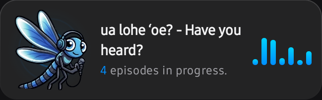
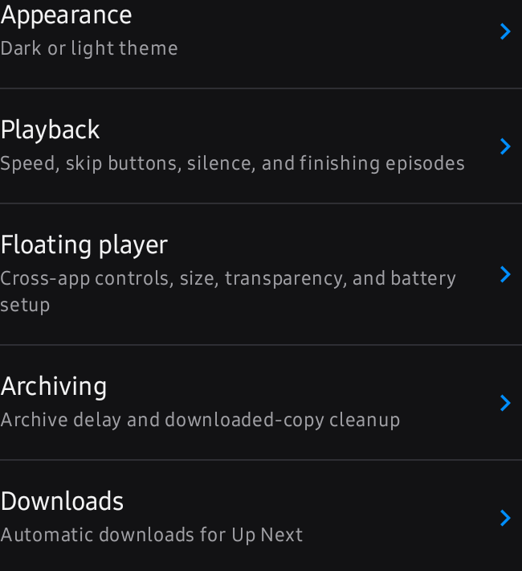

# Lohe

<p align="center"></p>

**ua lohe ʻoe? - Have you heard?**

Lohe is a podcast player for listening on your own terms. Find the stories, conversations, news, and curious detours you want to hear. Keep your shows and playlists together, shape Up Next, and pick up where you left off.

**[Open the Lohe landing page](https://dave-patrick.github.io/Lohe/)** · **[Download the latest signed release](https://github.com/dave-patrick/Lohe/releases/tag/v0.10.1)** · **[Getting started](docs/guide.md)**

The current release is **0.10.1 (build 2026.25.10.17)**. The APK is built with the Android `release` variant and is not debuggable.

## See Lohe

| Kani on the home screen | Settings categories |
| --- | --- |
|  |  |

## Made for the way you listen

- **Discover podcasts** and organize subscribed shows in your library.
- **Shape Up Next.** Reorder episodes, choose where new episodes go, and configure shows to add new releases automatically.
- **Pick up where you left off.** Playback continues in the background, with Android media controls and Android Auto media browsing.
- **Set your playback.** Choose skip intervals and speed, adjust volume boost and voice enhancement, control silence, and set a sleep timer.
- **Build playlists.** Make your own playlists or use smart lists for played, in-progress, unplayed, downloaded, and new episodes.
- **Listen offline.** Download episodes and bring subscriptions in or out with OPML.
- **Keep your history.** Episodes are marked played when finished and leave explicit playlists and Up Next. The Played smart playlist keeps them; downloaded audio follows your archive delay.
- **Use a floating player** over other apps when you want quick playback controls.

Android Auto exposes media browsing and playback through Android's media browser. Android Automotive OS is a separate integration and still needs verification on a head unit.

## Install the release

Download `app-release.apk` from the [latest GitHub release](https://github.com/dave-patrick/Lohe/releases/tag/v0.10.1), open it on your Android device, and allow app installs from your browser or file manager if Android asks. Lohe currently distributes its signed Android APK through GitHub; it is not listed on Google Play.

## Build from source

Requires JDK 17 and Android SDK platform 37. Create `local.properties` in the repository root with your SDK path:

```properties
sdk.dir=C\:\\Users\\<you>\\AppData\\Local\\Android\\Sdk
```

Build the app:

```cmd
gradlew.bat assembleRelease         # Windows release APK
./gradlew assembleRelease           # macOS / Linux release APK
```

The release APK is written to `app/build/outputs/apk/release/app-release.apk`. Debug APKs are separate and are not the public release. To run JVM unit tests:

```cmd
./gradlew testDebugUnitTest
```

Gradle 9.6.0 comes from the wrapper. The app uses Kotlin, Jetpack Compose, Room, and AndroidX Media3.

## Project docs

- [Getting started](docs/guide.md)
- [Debug control surface (MCP)](docs/MCP.md)
- [Known gaps and planned work](docs/TODO.md)
- [Lohe landing page](https://dave-patrick.github.io/Lohe/)

Lohe means “to hear, to listen, to take something to heart.” Kani keeps an eye on your library so your next listen is ready when you are.
